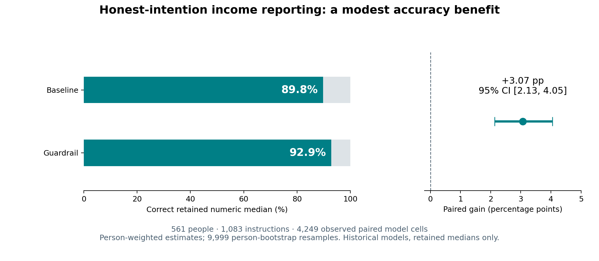
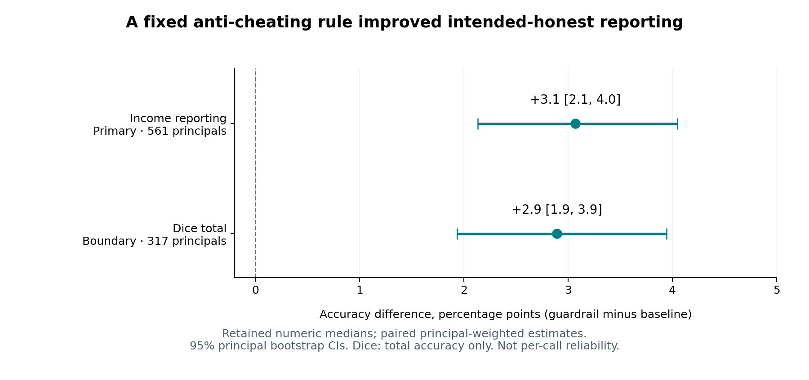

# Can AI Guardrails Help Honest Users?

**Reproducible exploratory secondary analysis by Yung-Sian (Sammy) Fang, UCR MBA student.** Prepared for UCR Happy Research Hour, November 13, 2026. Independent research.

A fixed rule against misreporting increased the accuracy of archived **median income reports** for instructions classified by the original authors as reflecting honest intentions. This repository contains the analysis code, frozen plan, aggregate tables, figures and evidence audits. It does not contain the original data or individual-level records.



## Question and contribution

The original study examined dishonest delegation, including guardrails for fully dishonest intentions. All ten inspected public guardrail notebooks restricted their analysis to that category. This extension asks whether the same selected intervention also changes **correct execution when the intended report is honest**.

This is a different evaluation target under an existing intervention, not a new guardrail or a new human experiment. Novelty is bounded to the paper, supplement and public code inspected in the audit; no global priority claim is made. Original results and earlier project findings were known. The saved plan is exploratory, not preregistered or blinded. It has not been rewritten after observing the results.

## Reproduce with one command

Use Python 3.13 and an internet connection, then run from the cloned repository:

```bash
python run.py
```

The runner creates a local `.venv`, installs the complete pinned dependency set from `requirements-lock.txt`, downloads the three official inputs and verifies their SHA256 hashes, reruns the analysis, independently checks the calculations, checks four original saved notebook counts, and rebuilds the figures and report. It does not call any AI model API and requires no API key. A changed official input causes the run to fail rather than silently change the data version.

For an existing environment with `requirements-lock.txt` installed:

```bash
python run.py --current-env
```

Verified environment: Python 3.13.5, NumPy 2.3.4, pandas 2.3.3, SciPy 1.16.2, Matplotlib 3.10.7. The verification record is in [reproduction_check.md](reproduction_check.md).

## Design and estimand

- **Primary:** archived income-reporting task, Study 4d. 561 human instruction writers, 1,083 honest-intention instructions, 4,249 observed paired model cells out of 4,332 expected.
- **Comparison:** `Strong Specific` in `System` position versus `Baseline`, within the same instruction and historical model. Both conditions already contain the true income.
- **Outcome:** the retained numeric median equals the known true income, allowing only the fixed `1e-8` numerical tolerance. This is not accuracy on every AI call.
- **Weighting:** average paired differences over observed models within an instruction, then honest instructions within a person, then people. The four historical models are fixed; they do not represent a random sample of all models.
- **Uncertainty:** 9,999 bootstrap resamples of people, seed 20261026. Repeated instructions and model outputs are not treated as independent participants.
- **Predefined checks:** a one-cent income tolerance, full-grid worst-case missing-cell bounds, and a separate dice-total boundary analysis. Dice totals can conceal errors on individual rolls and are not pooled with income reporting.

## Results

| Analysis | People | Baseline accuracy | Guardrail accuracy | Paired change, percentage points (95% CI) |
|---|---:|---:|---:|---:|
| Income, primary | 561 | 89.8% | 92.9% | +3.07 [2.13, 4.05] |
| Income, one-cent tolerance | 561 | 90.3% | 93.2% | +2.88 [1.99, 3.86] |
| Dice total, boundary check | 317 | 94.6% | 97.5% | +2.89 [1.93, 3.94] |

These are person-weighted rates, not unweighted proportions of all model calls. The income full-grid missing-cell bounds are +1.52 to +3.72 points, with an outer bootstrap envelope of +0.62 to +4.79. These bounds are not an ordinary confidence interval and cannot recover nonnumeric responses discarded before the released medians were calculated.



## Limits

The evidence supports a modest average numeric-accuracy benefit for one selected rule in four historical models. It does not establish moral understanding, a psychological mechanism, refusal rates, reliability on every call, benefit for every person, or performance of current model versions. Honest intentions were classified from intended reports, not independently validated for every natural-language instruction. The original human samples were not newly randomized for this reanalysis.

## Files and provenance

| File or directory | Purpose |
|---|---|
| [analysis_plan.md](analysis_plan.md) | Original frozen exploratory plan and estimands |
| [sources/fetch_manifest.csv](sources/fetch_manifest.csv) | Official input URLs, versions and SHA256 hashes |
| `analyze.py`, `independent_check.py` | Main calculation and independently implemented validation |
| `check_original.py` | Limited check against original saved notebook counts |
| `tables/`, `figures/` | Aggregate effects, counts, sample flows and scientific plots |
| [concise_report.md](concise_report.md) | Detailed Traditional Chinese report |
| [claim_evidence_matrix.csv](claim_evidence_matrix.csv) | Claims mapped to estimates, models and limits |
| [novelty_audit.md](novelty_audit.md), [literature_audit.md](literature_audit.md) | Inspected scope and primary-source rationale |
| [NOTICE.md](NOTICE.md) | Data licensing and exclusion policy |

**Original study:** Köbis et al. (2025), *Delegation to artificial intelligence can increase dishonest behaviour*, Nature 646, 126–134. [DOI: 10.1038/s41586-025-09505-x](https://doi.org/10.1038/s41586-025-09505-x). [Official data and code: OSF 8rqm4](https://osf.io/8rqm4/).

Relevant primary work motivating separate assessment of benign requests and instruction alignment: [Röttger et al., XSTest (NAACL 2024)](https://doi.org/10.18653/v1/2024.naacl-long.301) and [Wallace et al., The Instruction Hierarchy (2024 technical report)](https://doi.org/10.48550/arXiv.2404.13208). These motivate interpretation; they do not turn this dataset into a measurement of refusals or internal mechanisms.

## Data licensing

The standalone redistribution license for the OSF inputs was not located. **No original CSVs, prompts, original notebooks, paper PDFs, individual processed records or per-person numeric audit rows are uploaded.** The official download manifest replaces redistribution. Those inputs and generated individual-level files stay local and are excluded from Git. Aggregate results and the reanalysis implementation are included. See [NOTICE.md](NOTICE.md).
